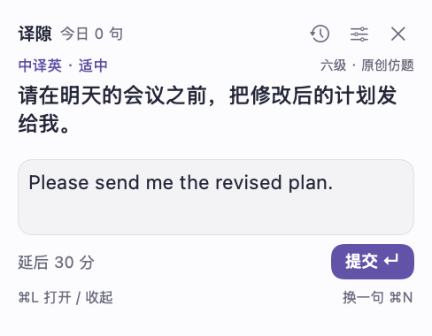
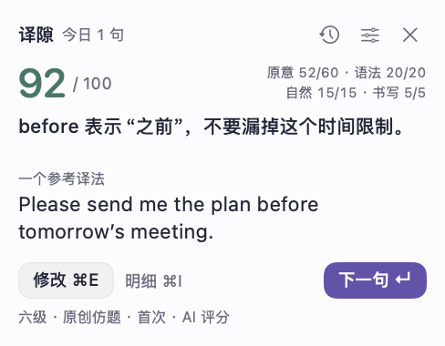

# 译隙 · TranslateGap

**菜单栏上的一句翻译练习：看一句，写译文，看反馈。**

用原生 Swift / SwiftUI 制作的 macOS 小工具。中译英与英译中交替，利用碎片时间练表达；草稿留在本机，想练时打开，想停时收起。

[词隙：配套的菜单栏背词工具](https://github.com/dagongzhanshi1/wordgap) · [详细使用说明](docs/USER_GUIDE.md) · [MIT 许可证](LICENSE)

## 界面预览

| 输入译文 | 评分反馈 |
| :---: | :---: |
|  |  |

截图来自模拟题目和模拟评分的离屏渲染，不包含个人数据，也不代表真实模型的评分结果。实际系统玻璃效果随背景和系统设置变化。

## 能做什么

| 功能 | 说明 |
| --- | --- |
| 单句轻量练习 | 固定 244 × 190 点菜单栏卡片；全局 `⌘L` 显示 / 收起，Esc 保留草稿。 |
| 双向与主题 | 中译英、英译中或交替；简单、适中、进阶；日常、学习、工作、科技、财经、混合主题。 |
| 克制的提醒 | 默认每 60 分钟浮现，不抢打字焦点，15 秒后收起；可关闭、调间隔或延后 30 分钟。锁屏 / 息屏时暂停。 |
| 提前准备题目 | 后台一次准备四句，有缓存时切题不用等网络；未完成的题与草稿不会被新题覆盖。 |
| AI 评分纠错 | 内容 60、语法 20、自然表达 15、书写 5，共 100 分；给出原片段、改法、理由和参考译法。 |
| 卡片内读明细 | `⌘I` 在同尺寸卡片内切换纠错、对照、更多；可连续滚动、键盘导航和复制。 |
| 修改与记录 | 第一次提交与修改重做分开统计；独立历史窗口查看明细、CSV 导出、批量删除和撤销删除。 |
| 清楚标注题源 | 真题节选 / 改编练习 / 原创仿题分开标注，附材料链接；旧记录缺少来源时不补猜。 |
| 按需联网找材料 | 可关闭的后台 Search / Fetch 材料补充，带每日预算、去重、来源约束及失败退避。 |
| 原生外观 | 浅色 / 深色 / 跟随系统，玻璃程度可调；尊重系统辅助功能设置。 |

**出题、AI 评分和联网找材料需要自己的 DeepSeek API Key 及网络。** 缓存、草稿和历史保存在本机，缓存切题不等待新一轮生成；未缓存的 AI 服务仍依赖网络。AI 反馈用于练习，不等同于考试成绩；没有实现自动错题间隔复习、自由长文写作或语音朗读。

## 快速开始

当前开源版本 **1.4.4**。源码面向 **Apple Silicon Mac**，运行要求 macOS 13 或更高版本，编译需要带 **macOS 26 SDK** 的 Apple Command Line Tools。当前构建目标为 `arm64`，无远程 Swift 包依赖。

```sh
git clone https://github.com/dagongzhanshi1/translategap.git
cd translategap
bash scripts/build.sh
open dist/译隙.app
```

构建脚本使用 `/Library/Developer/CommandLineTools` 中的 Swift 编译器。产物在 `dist/译隙.app`，缓存在 `.build/`；`TRANSLATEGAP_APP_PATH` 与 `TRANSLATEGAP_BUILD_PATH` 可指定其他绝对路径。采用本机 ad-hoc 签名，未做 Developer ID 公证；仓库没有提供经过苹果公证的安装包。macOS 26 使用原生玻璃，旧系统使用替代材质。

启动后在偏好设置中输入自己的 DeepSeek API Key，并使用“测试连接”查看模型。源码默认模型名为 `deepseek-flash`，实际可用模型与 Search / Fetch 支持取决于服务端及你的账户，应以连接测试为准。

## 练习流程

1. 选翻译方向、难度和主题，读取卡片上的短句。
2. 写译文，按回车提交；失败时保留原题与草稿，可重试。
3. 看总分和重点反馈，`⌘I` 查看具体纠错与参考译法。
4. `⌘E` 修改重做，或回车 / `⌘N` 开始下一句。

分数由经过本地校验的扣分项计算，不直接接受任意模型总分。结构或扣分明细不合格时，最多请求一次纠正；仍不合格就保留草稿，不写入成绩。旧版十分制记录保留原分，不转换成百分制。

## 题源与材料

仓库内有 **8 条参考材料记录**：3 条六级短句节选及 5 条雅思官方样题参考条目。它们是已有目录快照，原有核对日期保存在 [`Resources/参考材料.json`](Resources/参考材料.json)，不表示网页今天仍可访问或已经重新核对。

- **真题节选**：从记录的材料中逐字摘录短句，附出处。六级参考包含第三方整理页，不宣称持有官方原卷。
- **改编练习**：参考主题与表达点重新写作，明确标为改编。
- **原创仿题**：模型生成独立练习，不虚构试卷年份和链接。

雅思参考指阅读 / 写作样题，用来练表达，不称为“雅思翻译真题”。联网找材料有固定来源范围：六级采用受约束的新东方整理页，雅思采用 IELTS 官方页面。材料与题目保留来源快照，联网失败不清空草稿。详见[材料授权和来源说明](THIRD_PARTY_NOTICES.md)。

## 隐私与备份

- Key 只写入 macOS 钥匙串，service 为 `local.translategap.deepseek`；本机编译或迁移后可能需要重新保存，不随代码分发。
- 数据在 `~/Library/Application Support/TranslateGap/state.json`，上一份有效状态保留为 `state-backup.json`，包括草稿、当前题、题目缓存、历史与设置。
- 出题发送偏好、少量最近题目及公开参考主题；评分发送当前原句、你的译文和练习点。材料搜索使用考试检索词和公开网页，不把个人译文作为搜索词。
- API 调用使用自己的账户，可能计费。联网材料补充默认开启，可在设置关闭；每批最多两次搜索、四页抓取，每天最多四批，另有正常出题、评分和材料整理的模型请求。
- 没有项目账号或云同步。CSV 用于阅读与分析，**不等于完整可恢复备份**；完整备份应在退出应用后复制整个 TranslateGap 文件夹。

## 快捷键

| 按键 | 作用 |
| --- | --- |
| `⌘L` | 全局显示 / 收起卡片 |
| `回车` 或 `⌘回车` | 提交；反馈页进入下一句 |
| `Shift 回车` | 输入换行 |
| `⌘E` | 修改译文 |
| `⌘I` | 打开 / 关闭当前题明细 |
| `⌘1 / ⌘2 / ⌘3` | 明细切换纠错 / 对照 / 更多 |
| `⌘N` | 下一句，未提交草稿不会被丢弃 |
| `⌘D` | 延后 30 分钟 |
| `⌘,` | 偏好设置 |
| `Esc` | 返回反馈或收起，保留草稿 |

卡片明细支持方向键、Page Up / Down、空格、Home / End 滚动。除全局唤出外，快捷键在相应窗口生效；中文输入法有未确认候选时，回车先确认输入。

## 开发与验证

```sh
# 使用临时目录、模拟出题与评分，不访问真实接口或日常记录
./dist/译隙.app/Contents/MacOS/TranslateGap --self-test

# 用模拟数据生成界面截图
./dist/译隙.app/Contents/MacOS/TranslateGap --render-previews /tmp/translategap-previews
```

离线检查覆盖草稿保留、并发提交、缓存、评分校验、旧记录、来源、材料研究、历史管理、明细导航及状态恢复。源码中 `live-test` 系列会调用真实服务并可能产生费用，不属于上述离线检查。

| 目录 | 内容 |
| --- | --- |
| `Sources/` | 菜单栏与 SwiftUI 界面、状态保存、DeepSeek、评分校验、题源与内置测试 |
| `Resources/` | 参考材料目录与隐私说明 |
| `scripts/` | 构建与图标生成 |
| `docs/` | 使用说明与模拟截图 |

## 开源与授权

程序源码采用 [MIT License](LICENSE)。外部考试材料、网站内容和商标的权利归各自权利人；代码的 MIT 授权不自动覆盖它们。参见 [THIRD_PARTY_NOTICES.md](THIRD_PARTY_NOTICES.md)。

欢迎提交 Issue 或 Pull Request，参见 [CONTRIBUTING.md](CONTRIBUTING.md)。
